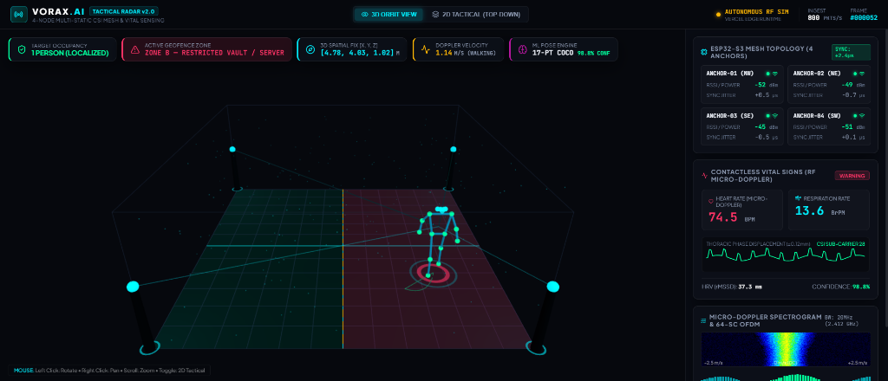
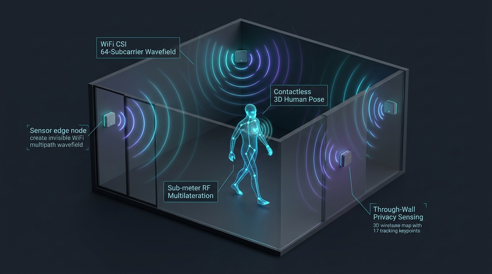
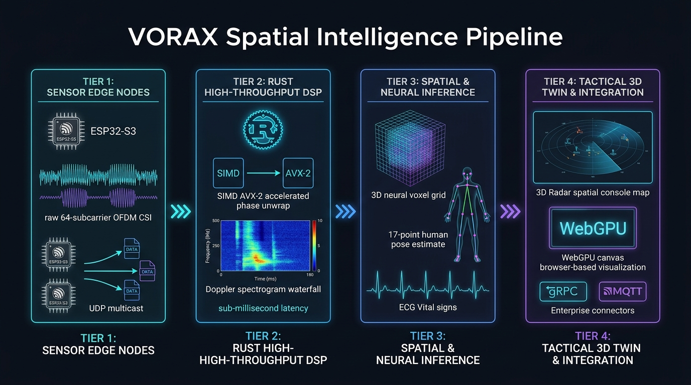

# VORAX

**Camera-free spatial intelligence — built on WiFi physics, not pixels.**

VORAX transforms commodity WiFi signals into real-time spatial awareness: human presence, 3D positioning, skeletal pose reconstruction, and contactless vital sign monitoring — through walls, without cameras, without wearables.

Built for enterprise-grade deployment across security, industrial safety, and healthcare verticals.

  

  <em>Real-time 4-node multi-static CSI tactical radar simulation: 17-point skeletal pose tracking, sub-meter multilateration, geofence breach telemetry, and contactless vital signs monitoring (final production hardware build underway).</em>

---

## What VORAX Does

| Capability | Detail |
|------------|--------|
| **Presence Detection** | > 97% accuracy, through drywall and glass partitions |
| **3D Localization** | Sub-meter positioning from a 4-node mesh |
| **Skeletal Tracking** | 17-keypoint body pose at 30 FPS |
| **Vital Sign Monitoring** | ±3 BPM heart rate, respiratory rate, HRV — contactless |
| **Fall Detection** | Real-time biomechanical event classification |
| **Perimeter Sensing** | Open yards, container fields, warehouse floor mesh |

No camera feed. No PII. No wearables. Privacy-by-design.

---

## How It Works

VORAX exploits **WiFi Channel State Information (CSI)** — the per-subcarrier complex amplitude and phase data embedded in every 802.11n packet. When a human moves in a space, they disturb the multipath propagation of RF signals in physically deterministic ways. VORAX captures, sanitizes, and decodes those disturbances in real time.

  

### Pipeline Architecture

  

* **Tier 1: Sensor Edge Nodes** — ESP32-S3 sensor mesh capturing 64-subcarrier OFDM CSI at 200 Hz with microsecond timestamp sync and UDP multicast streaming.
* **Tier 2: Rust DSP Processing Engine** — Zero-copy ring buffer with SIMD AVX-2 accelerated phase unwrapping, Hampel/Fresnel filtering, and Doppler STFT generation (< 1.2 ms packet-to-tensor latency).
* **Tier 3: Spatial & Neural Inference** — 3D neural voxel grid with Temporal CNN for 17-point skeletal pose estimation alongside VMD and CWT contactless vital sign extraction (BPM, HRV, respiratory rate).
* **Tier 4: Tactical 3D Digital Twin & Enterprise APIs** — Real-time WebGPU / Three.js spatial radar console with enterprise connectors for gRPC, WebSockets, Protobuf, MQTT, ROS2, and ONVIF Profile M.

---

## Tech Stack

| Layer | Technology |
|-------|-----------|
| Sensor firmware | ESP-IDF (C), ESP32-S3 |
| DSP core | Rust · tokio · crossbeam · std::simd (AVX2) · Flatbuffers |
| ML inference | ONNX Runtime · TensorRT · OpenVINO · PyTorch (training) |
| Edge gateway | Rockchip RK3588 — 6 TOPS NPU, < 10W |
| Dashboard | React · Three.js · WebGPU · WebSockets |
| Data layer | TimescaleDB · Redis |
| Integrations | gRPC · MQTT · ROS2 · SIA DC-09 · ONVIF Profile M |

---

## Target Verticals

**Security & Perimeter**
Through-wall intrusion detection, container yard perimeter mesh, blind-spot coverage for camera-dark zones.

**Industrial & Warehouse**
Forklift blind-spot safety interlocks, AMR/AGV human proximity alerts, real-time floor occupancy for WMS integration.

**Healthcare & Eldercare**
Contactless bed-exit detection, fall alerting, non-diagnostic vital sign telemetry for assisted living and ICU monitoring.

---

## Development Phases

| Phase | Scope | Timeline |
|-------|-------|----------|
| **0 — Foundation** | Rust ingest scaffold, CSI simulator, ring buffer, packet parser | Week 1 |
| **1 — Hardware** | ESP32-S3 firmware, dual-node capture, SIMD DSP | Week 2 |
| **2 — Biometrics** | STFT Doppler, VMD vitals, CWT BPM extraction | Weeks 3–4 |
| **3 — Spatial ML** | 2D-MUSIC AoA, 3D voxel grid, skeleton TCN, ONNX export | Weeks 5–8 |
| **4 — Dashboard** | Three.js 3D canvas, WebSocket streaming, enterprise integrations | Weeks 9–12 |
| **5 — Pilots** | Warehouse & healthcare field deployments | Weeks 13–16 |

---

## Privacy & Compliance

VORAX is **privacy-by-design**:
- No video. No images. No audio.
- No biometric identifiers stored — only aggregate spatial vectors.
- GDPR compliant by architecture: no PII is ever captured or transmitted.
- Healthcare deployments operate as Class I non-diagnostic safety devices (no FDA 510(k) required for Phase 1).

---

## Status

> 🚀 **Phase 4 & ML Pose Distillation Complete — Final Production Hardware Build Underway**
>
> 🌐 **Interactive Tactical Console**: Explore the live simulation at [vorax-bice.vercel.app](https://vorax-bice.vercel.app)

---

## License

Proprietary. All rights reserved. © 2026 VORAX.
