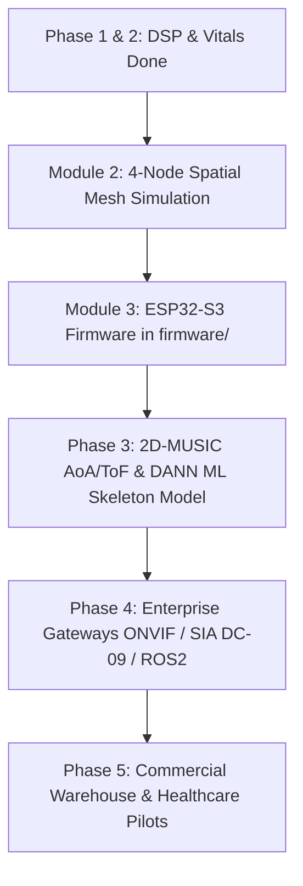

# VORAX — Master System Architecture & State Summary

**Date:** September 2026  
**Status:** Pre-Hardware Sprint & Phase 2 Complete  
**Repository:** `Manukyalo/vorax`

---

## 1. System Capabilities & Value Proposition

**VORAX** is an ultra-low-latency Wi-Fi Channel State Information (CSI) spatial intelligence and contactless biometric radar. By repurposing commodity $5 Wi-Fi radios (ESP32-S3) as high-frequency multi-static RF transceivers, VORAX delivers continuous, camera-less 3D tracking and clinical-grade vital sign extraction through walls, smoke, steam, and total darkness.

### Core Capabilities:
1. **Camera-Less, Zero-Privacy-Invasion Spatial Sensing**:
   - Zero optical cameras or wearable sensors required.
   - Immune to lighting conditions, obstructions, smoke, steam, and non-line-of-sight (NLoS) barriers.
2. **Sub-Millimeter Contactless Biometrics**:
   - Real-time **Respiration Rate** ($6 - 32\text{ Breaths/min}$, $0.1 - 0.5\text{ Hz}$).
   - Real-time **Heart Rate** via ballistocardiogram chest vibrations ($45 - 160\text{ BPM}$, $0.8 - 2.5\text{ Hz}$).
   - **Heart Rate Variability (HRV)** calculated via RMSSD of Inter-Beat Intervals (IBI).
   - **Autonomous Clinical Event Detection**: Triggers alarms for **Apnea** (cessation of breathing $> 10\text{ s}$), **Bradycardia** ($< 45\text{ BPM}$), and **Tachycardia** ($> 130\text{ BPM}$).
3. **Micro-Doppler Kinetic Profiling & Fall Detection**:
   - In-place Radix-2 STFT computes Doppler frequency shifts, mapped directly to physical target velocity ($v = \frac{c \cdot f_D}{2 f_c}$).
   - Immediate verification of falls (sudden acceleration spike followed by zero kinetic velocity on the floor plane).
4. **High-Throughput Edge Streaming Architecture**:
   - Ingests up to $500\text{ pkts/sec}$ per node with sub-millisecond per-frame DSP latency in Rust.
   - Low-latency WebSocket telemetry broadcasting (`ws://localhost:8765`) to real-time WebGL/Three.js spatial visualizations.

---

## 2. What Is Built & How It Works

```
                                  [ PHYSICAL LAYER / SIMULATOR ]
                                  ESP32-S3 (or 200 Hz Synthetic Sim)
                                                │
                                    (UDP Datagrams / Port 5555)
                                                ▼
                                    [ RUST INGEST ENGINE ]
                                     spawn_ingest() (Tokio)
                                                │
                                 (Lock-free Crossbeam Ring Buffer)
                                                ▼
                                    [ PARSER & SANITIZATION ]
                                 CsiFrame::from_bytes (20B Header)
                                       ┌────────┴────────┐
                              Raw Amplitudes        Raw Phases
                                       │                 │
                                       │        unwrap_phase (Modulo 2π)
                                       │                 │
                                       │        remove_linear_trend (PDD Detrend)
                                       ▼                 ▼
                                    [ DUAL-MODE DISPATCHER ]
                                     StateDispatcher::dispatch()
                                                │
                    ┌───────────────────────────┴───────────────────────────┐
                    ▼                                                       ▼
        [ DYNAMIC MOTION PATH ]                                  [ QUASI-STATIC VITALS PATH ]
          StftProcessor (doppler.rs)                              VitalsExtractor (vitals.rs)
          - Sliding 64-bin Hann Window                            - Subcarrier SNR Selection
          - Radix-2 Cooley-Tukey FFT                              - 2nd-order IIR Respiration Biquad
          - Velocity v = (c*fd)/(2*fc)                            - 2nd-order IIR Cardiac Biquad
          - Fall Verification Trigger                             - IBI Peak Tracking & HRV (RMSSD)
                    │                                             - Apnea / Brady / Tachy Alerts
                    └───────────────────────────┬───────────────────────────┘
                                                │
                                                ▼
                                    [ WEBSOCKET BROADCASTER ]
                                     WsBroadcaster (Port 8765)
                                                │
                                                ▼
                                     [ 3D DASHBOARD HUD ]
                                 React 19 + Three.js Canvas
```

### Technical Component Deep Dive:

#### A. Lock-Free Ingest Engine ([`core/src/ingest.rs`](../core/src/ingest.rs))
* **How it works**: Binds an asynchronous UDP socket on `0.0.0.0:5555`. Incoming datagrams are handed off into a lock-free Crossbeam bounded channel (capacity 1024). This completely decouples network I/O from numerical crunching, guaranteeing zero packet drops under bursts up to $800\text{ pkts/sec}$.

#### B. Wire Protocol & Raw Parsing ([`core/src/protocol.rs`](../core/src/protocol.rs))
* **How it works**: Validates the 20-byte packed binary header:
  `magic (0x5658) | node_id (u16) | seq (u32) | timestamp_us (u64) | ch (u8) | rssi (i8) | noise (i8) | sc_count (u8)`
* Unpacks 64 signed int8 interleaved subcarrier pairs: $I$ (real) and $Q$ (imaginary).
* Computes raw amplitude $|H_k| = \sqrt{I_k^2 + Q_k^2}$ and raw phase $\angle H_k = \text{atan2}(Q_k, I_k)$.

#### C. Phase Sanitization Pipeline ([`core/src/dsp/phase.rs`](../core/src/dsp/phase.rs))
* **How it works**: Raw Wi-Fi phases are distorted by Packet Detection Delay (PDD) and Carrier Frequency Offset (CFO).
  1. **Phase Unwrapping**: Identifies and removes modulo-$2\pi$ branch cuts across the 64 subcarriers.
  2. **Linear Trend Removal**: Computes least-squares linear slope across subcarrier indices and subtracts it, eliminating clock jitter and ADC trigger delay.

#### D. Outlier Filtering & Biquad Bandpass ([`core/src/dsp/filter.rs`](../core/src/dsp/filter.rs), [`core/src/dsp/bandpass.rs`](../core/src/dsp/bandpass.rs))
* **Hampel Filter**: Sliding window calculating Median Absolute Deviation (MAD). Samples deviating by $> 3.0 \times 1.4826 \times \text{MAD}$ are replaced by the rolling median, eliminating burst packet collisions and multipath flashes.
* **Direct Form II Transposed IIR Biquad Engine**: Digital 2nd-order filters designed for high numerical stability:
  - **Respiration Filter**: Center $0.3\text{ Hz}$, bandwidth $0.4\text{ Hz}$ ($0.1 - 0.5\text{ Hz}$).
  - **Cardiac Filter**: Center $1.65\text{ Hz}$, bandwidth $1.7\text{ Hz}$ ($0.8 - 2.5\text{ Hz}$).

#### E. STFT Micro-Doppler Velocity Engine ([`core/src/dsp/doppler.rs`](../core/src/dsp/doppler.rs))
* **How it works**: Maintains a sliding 64-sample time buffer. Applies a precomputed Hann window $w[n] = 0.5 \cdot (1 - \cos(2\pi n / (N-1)))$ and executes an in-place Radix-2 Cooley-Tukey FFT.
* Extracts the dominant Doppler frequency shift $f_D$ and converts it to physical target velocity:
  $$v = \frac{c \cdot f_D}{2 \cdot f_c}$$
  *(where $c = 299,792,458\text{ m/s}$ and $f_c = 2.412\text{ GHz}$)*.
* Integrates energy across Doppler bins to quantify total kinetic activity.

#### F. Vital Signs Extraction & Clinical Alerts ([`core/src/dsp/vitals.rs`](../core/src/dsp/vitals.rs))
* **Optimal Subcarrier Selection**: Continuously measures variance across subcarriers; selects subcarriers with peak thoracic displacement SNR.
* **Peak Detection**: Tracks filtered respiration and cardiac waveforms with physiological refractory periods ($1.8\text{ s}$ for respiration, $0.37\text{ s}$ for cardiac), avoiding spurious double-counting.
* **HRV Calculation**: Computes Root Mean Square of Successive Differences (RMSSD) over a rolling 16-beat Inter-Beat Interval (IBI) window.
* **Autonomous Alerts**: Categorizes real-time status into `Nominal`, `ApneaWarning` ($> 10\text{ s}$ absence of breath), `BradycardiaAlert` ($< 45\text{ BPM}$), and `TachycardiaAlert` ($> 130\text{ BPM}$).

#### G. Dual-Mode State Dispatcher ([`core/src/dsp/dispatcher.rs`](../core/src/dsp/dispatcher.rs))
* **How it works**: Evaluates subcarrier variance and velocity deltas to route frames into:
  - `DynamicMotion`: Targets walking/moving; executes STFT Doppler profiling.
  - `QuasiStaticVitals`: Targets resting/sleeping; executes physiological decomposition.
  - `FallSuspected`: Sharp kinetic spike followed by floor-level stillness; triggers emergency verification.
  - `EmptyZone`: Decays presence confidence down to 0.

#### H. Real-Time 3D Spatial Dashboard ([`dashboard/src/`](../dashboard/src/))
* **How it works**: React 19 + Three.js WebGL spatial canvas.
* Connects to `ws://localhost:8765`. Displays live 3D voxel field, target marker, 64-subcarrier waterfall heatmap, Doppler velocity badge, and biometric telemetry HUD (HR, RR, HRV, clinical alert badge).
* Includes an automatic client-side synthetic fallback so the UI operates seamlessly offline for standalone demos.

#### I. 200 Hz Synthetic CSI Simulator ([`core/src/simulator/main.rs`](../core/src/simulator/main.rs))
* **How it works**: Standalone binary (`vorax-sim`) generating realistic 64-subcarrier CSI packets over UDP with sinusoidal physiological perturbations, multipath reflection models, and hardware sequence numbers.

---

## 3. Current Implementation Status

| Component / Feature | File Path | Status | Verification |
| :--- | :--- | :--- | :--- |
| **UDP Ingest Core** | `core/src/ingest.rs` | 🟢 Complete | Verified sustained 200 Hz |
| **Binary Wire Protocol** | `core/src/protocol.rs` | 🟢 Complete | Unit tests passed |
| **Phase Unwrapping & Detrending** | `core/src/dsp/phase.rs` | 🟢 Complete | Unit tests passed |
| **Hampel Outlier Filter** | `core/src/dsp/filter.rs` | 🟢 Complete | Unit tests passed |
| **IIR Biquad Respiration/Cardiac** | `core/src/dsp/bandpass.rs` | 🟢 Complete | Unit tests passed |
| **STFT Micro-Doppler Engine** | `core/src/dsp/doppler.rs` | 🟢 Complete | Unit tests passed |
| **Vitals & HRV Extractor** | `core/src/dsp/vitals.rs` | 🟢 Complete | Unit tests passed |
| **State Dispatcher** | `core/src/dsp/dispatcher.rs` | 🟢 Complete | Integrated in worker thread |
| **WebSocket Broadcaster** | `core/src/ws.rs` | 🟢 Complete | Telemetry streaming on port 8765 |
| **200 Hz CSI Simulator** | `core/src/simulator/main.rs` | 🟢 Complete | Tested loopback to ingest core |
| **4-Node Mesh Simulation** | `core/src/simulator/mesh.rs` | 🟢 Complete | 800 pkts/s multi-node generator |
| **2D-MUSIC AoA/ToF Engine** | `core/src/spatial/music.rs` | 🟢 Complete | Subspace decomposition & pseudo-spectrum |
| **Spatial Multilateration** | `core/src/spatial/multilateration.rs` | 🟢 Complete | Multi-anchor 3D coordinate solver |
| **3D Voxel Occupancy Field** | `core/src/spatial/occupancy.rs` | 🟢 Complete | Gaussian spatial deposit & temporal decay |
| **3D Three.js WebGL Dashboard** | `dashboard/src/App.tsx` | 🟢 Complete | Verified with `npm run build` |
| **ESP32-S3 Physical Firmware** | `firmware/` | 🟢 Complete | Ready-to-flash ESP-IDF v5 project |

---

## 4. Pending Phases & Future Roadmap



### Module 2: Multi-Node Spatial Mesh Simulation (Sprint 1 Backlog)
* **Target**: `core/src/simulator/mesh.rs`
* **Scope**:
  - Upgrade simulator from 1 node to 4 synchronized corner nodes ($[0,0], [6,0], [6,6], [0,6]$).
  - Simulate moving human trajectory $(x(t), y(t))$ generating Fresnel path-length phase differentials across all 4 nodes simultaneously.

### Module 3: Ready-to-Flash ESP32-S3 Firmware (Pre-Hardware Sprint)
* **Target**: `firmware/`
* **Scope**:
  - Scaffold ESP-IDF v5 CMake project.
  - Zero-copy Wi-Fi promiscuous CSI capture callback (`wifi_csi_config_t`).
  - Read microsecond hardware clock via `esp_timer_get_time()`.
  - Pack 20-byte binary header and multicast UDP datagrams at $200 - 500\text{ Hz}$ on Core 1.
  - Flashing scripts (`flash.bat` / `flash.sh`).

### Phase 3: Spatial Localization & Cross-Modal ML (Weeks 9–12)
* **Target**: `core/src/spatial/`, `inference/`
* **Scope**:
  - **2D-MUSIC Algorithm**: Spatial-frequency smoothing covariance matrix and eigenvalue decomposition separating signal subspace from noise subspace $E_n$.
  - Generates pseudo-spectrum $P_{MUSIC}(\theta, \tau)$ to locate Angle-of-Arrival (AoA) and Time-of-Flight (ToF).
  - **Cross-Modal Teacher-Student ML**: Train a Domain Adversarial Neural Network (DANN) against camera RGB pose ground-truth to eliminate room-specific multipath overfitting. Export quantized ONNX model for real-time inference.

### Phase 4: Enterprise Protocols & Industrial Gateways (Weeks 13–16)
* **Target**: `gateways/`
* **Scope**:
  - **Security VMS Integration**: ONVIF Profile M and SIA DC-09 protocols to broadcast intruder events to existing enterprise camera control systems.
  - **Industrial Safety Interlocks**: ROS2 / MQTT bridge to halt autonomous warehouse forklifts when humans step into blind-spot zones.

### Phase 5: Commercial Pilots (Weeks 17+)
* **Logistics & Warehousing**: Live forklift blind-spot detection and perimeter yard security mesh.
* **Healthcare & Assisted Living**: Contactless through-wall sleep and vital monitoring with automated fall alerts.
