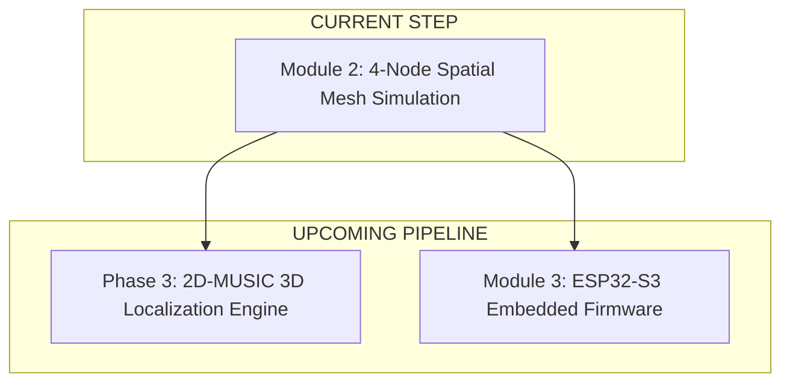

# VORAX — Execution Task List: Module 2, Phase 3, and Module 3

**Date:** September 2026  
**Status:** Complete (Module 2, Phase 3, and Module 3 Verified)  
**Target:** Monorepo (`core/`, `dashboard/`, `firmware/`, `inference/`)

---

## Master Sprint Overview

---

## 1. Module 2: 4-Node Spatial Mesh Simulation (`core/src/simulator/`)
**Objective:** Generate a realistic 4-anchor spatial RF mesh streaming 800 pkts/s to simulate human movement through Fresnel zones before physical hardware is deployed.

| Task ID | Component | File Target | Scope Description | Status |
| :--- | :--- | :--- | :--- | :--- |
| **M2-01** | Mesh Node Geometry | `core/src/simulator/mesh.rs` | 4 corner nodes: Node 1 $(0,0,1.2)$, Node 2 $(6,0,1.2)$, Node 3 $(6,6,1.2)$, Node 4 $(0,6,1.2)$ with synchronized $\mu s$ clock | 🟢 Complete |
| **M2-02** | Moving Target Physics | `core/src/simulator/mesh.rs` | Human walking trajectory $(x(t), y(t))$ generating distance deltas and Doppler shifts relative to each node | 🟢 Complete |
| **M2-03** | Multi-Node RF Synthesis | `core/src/simulator/mesh.rs` | Generates 64-subcarrier complex $I/Q$ data with free-space path loss and path-length phase shifts per node | 🟢 Complete |
| **M2-04** | 800 Hz UDP Mesh Streamer | `core/src/simulator/main.rs` | Streams 4 distinct interleaved node streams at 200 Hz each (800 pkts/sec aggregate) via `--mesh` flag | 🟢 Complete |
| **M2-05** | Multi-Node Ingest Validation| `core/src/main.rs` | Ingest engine tracks, separates, and logs telemetry across all 4 nodes without packet loss | 🟢 Complete |

---

## 2. Phase 3: 2D-MUSIC AoA/ToF 3D Localization Engine (`core/src/spatial/`)
**Objective:** High-resolution spatial localization converting multi-node CSI matrices into 3D voxel coordinates and occupancy clouds.

| Task ID | Component | File Target | Scope Description | Status |
| :--- | :--- | :--- | :--- | :--- |
| **P3-01** | Covariance Smoothing | `core/src/spatial/smoothing.rs` | Spatial-frequency forward-backward smoothing covariance matrix across subcarriers and nodes | 🟢 Complete |
| **P3-02** | 2D-MUSIC Spectrum Engine | `core/src/spatial/music.rs` | Eigenvalue decomposition, noise subspace $E_n$ projection, and 2D $(\theta, \tau)$ pseudo-spectrum search | 🟢 Complete |
| **P3-03** | 3D Voxel Multilateration | `core/src/spatial/multilateration.rs`| Intersects AoA bearings and ToF ellipses from 4 nodes to compute 3D target coordinates $(x, y, z)$ | 🟢 Complete |
| **P3-04** | Point-Cloud Occupancy Grid | `core/src/spatial/occupancy.rs` | Volumetric 3D occupancy grid with decaying persistence for obstacle & human detection | 🟢 Complete |
| **P3-05** | 3D Dashboard Node Anchor Display | `dashboard/src/components/SpatialCanvas.tsx` | Visualizes the 4 spatial node hardware anchors, real-time target trajectory, and 3D fix HUD in Three.js | 🟢 Complete |

---

## 3. Module 3: Ready-to-Flash ESP32-S3 Firmware (`firmware/`)
**Objective:** Production-grade ESP-IDF v5 embedded firmware ready to flash immediately onto physical ESP32-S3 boards.

| Task ID | Component | File Target | Scope Description | Status |
| :--- | :--- | :--- | :--- | :--- |
| **M3-01** | ESP-IDF v5 Project | `firmware/CMakeLists.txt` | Scaffolds standard ESP-IDF v5 project structure, partitions, and `sdkconfig.defaults` | 🟢 Complete |
| **M3-02** | Promiscuous CSI Capture | `firmware/main/csi_rx.c` | Zero-copy `wifi_csi_config_t` promiscuous capture callback with FreeRTOS ring buffer handoff | 🟢 Complete |
| **M3-03** | Packet Builder | `firmware/main/packet_builder.c` | Microsecond clock serialization from `esp_timer_get_time()` and 20-byte VORAX header formatting | 🟢 Complete |
| **M3-04** | High-Speed UDP Multicast | `firmware/main/udp_sender.c` | Dedicated FreeRTOS task pinned to Core 1 multicasting 200–500 Hz UDP frames | 🟢 Complete |
| **M3-05** | Flashing & Deployment Scripts | `firmware/flash.bat` / `flash.sh` | One-click build, flash, and serial monitor automation scripts (`idf.py flash monitor`) | 🟢 Complete |

---

## 4. Phase 4: Enterprise Physical Security Integration & Forensics Gateways (`gateways/`)
**Objective:** Bridge real-time spatial RF presence into commercial VMS, central station alarm receivers, and robotics brokers with immutable forensic audit logging.

| Task ID | Component | File Target | Scope Description | Status |
| :--- | :--- | :--- | :--- | :--- |
| **P4-01** | Gateway Monorepo Workspace | `Cargo.toml`, `gateways/Cargo.toml` | Establishes multi-crate workspace for `core` and `vorax-gateway` | 🟢 Complete |
| **P4-02** | Event Classifier & Translation | `gateways/src/event.rs` | Translates raw telemetry into discrete `VoraxEvent` lifecycle states with debounce & zone tagging | 🟢 Complete |
| **P4-03** | ONVIF Profile M Push | `gateways/src/onvif.rs` | SOAP 1.2 WS-BaseNotification push to VMS (Milestone XProtect, Genetec, Axis ACS) | 🟢 Complete |
| **P4-04** | SIA DC-09 / Contact ID | `gateways/src/sia_dc09.rs` | TCP socket dispatcher with Contact ID (CID) format and CRC-16/CCITT verification | 🟢 Complete |
| **P4-05** | MQTT / ROS2 Bridge | `gateways/src/mqtt.rs` | Industrial MQTT pub/sub with QoS 1 for safety triggers and QoS 0 for trajectory streams | 🟢 Complete |
| **P4-06** | Forensic Audit Logging | `core/src/audit.rs`, `gateways/src/audit.rs` | Dual-tier append-only JSONL audit logs for core state transitions and gateway dispatches | 🟢 Complete |
| **P4-07** | Edge Containerization | `gateways/Dockerfile` | Multi-stage Docker deployment for edge NUCs, IPCs, and Raspberry Pi 4 | 🟢 Complete |
